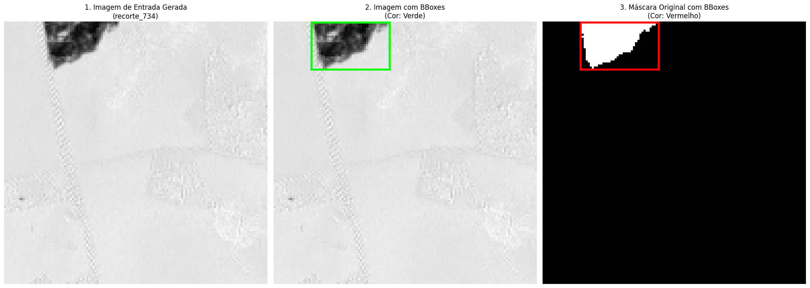
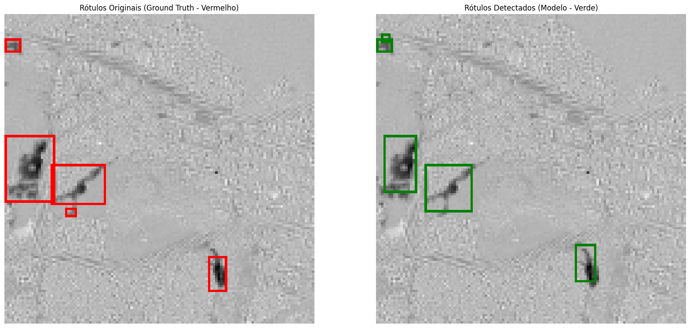
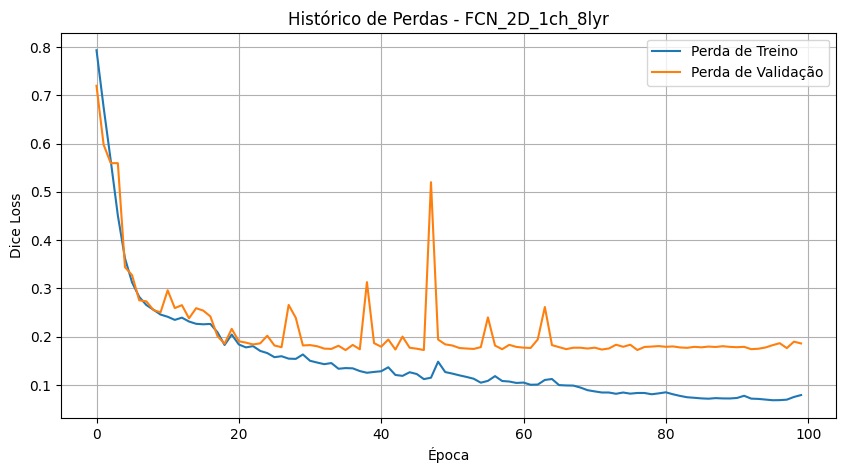
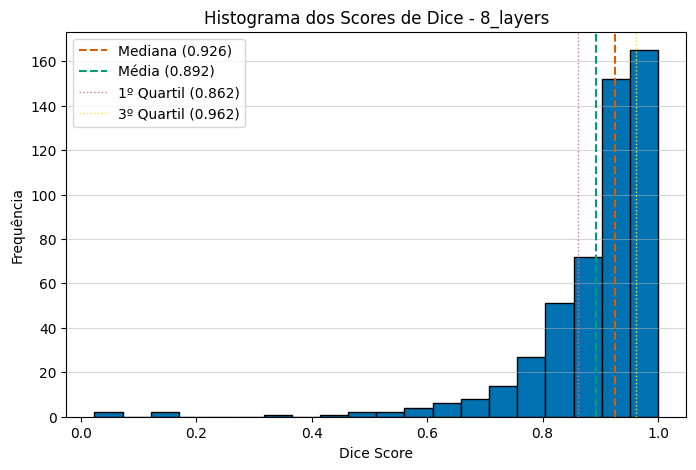
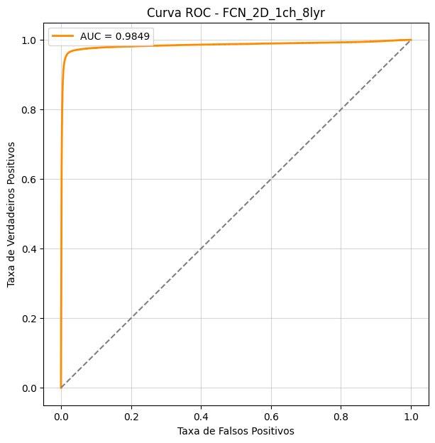
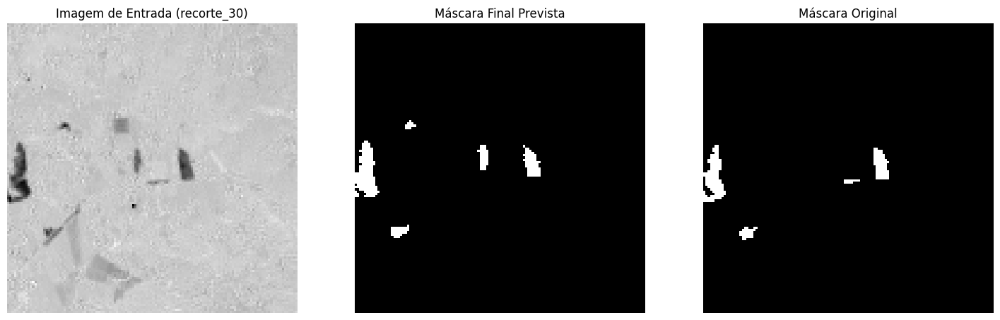
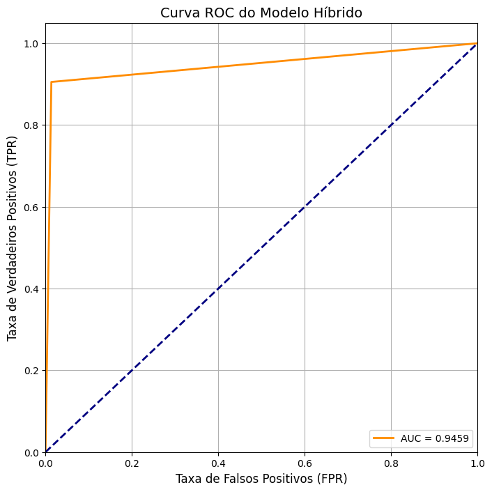

# Segmentação de cicatrizes de queimada em duas etapas: SSD + FCN

Pipeline de detecção e segmentação de cicatrizes de queimada (*burn scars*) em imagens de sensoriamento remoto, combinando a rapidez de um detector com a precisão espacial de uma rede de segmentação.

## Contexto: Hackathon WorCAP 25

Este projeto foi desenvolvido para o **Hackathon: Detecção de Áreas Queimadas através de Imagens de Satélite**, do **Workshop em Computação Aplicada 2025 (WorCAP 25)**, realizado de 01/09/2025 a 08/09/2025 em São José dos Campos.

- **Prazo:** tivemos **uma semana** para desenvolver a solução completa.
- **Resultado:** nossa equipe ficou entre os **10 melhores colocados (Top 10)**.
- **Requisito:** o regulamento exigia que **toda a solução estivesse contida em um único notebook**. Por isso, dataset, modelos, treino, inferência e avaliação ficam todos em `SSD_FCN.ipynb`, em vez de módulos `.py` separados.

## Visão geral

1. **Detecção (SSD300)**: o *Single Shot MultiBox Detector* [Liu et al., 2016] prevê *bounding boxes* de cicatrizes de queimada em múltiplas escalas.
2. **Segmentação (FCN)**: cada região detectada é processada por uma *Fully Convolutional Network* [Long et al., 2015] adaptada para imagens 2D de canal único (`FCN_2D_1ch_8lyr`), que gera a máscara detalhada da cicatriz.

A entrada da FCN é o índice **NBRSWIR** (*Normalized Burn Ratio – Short-Wave Infrared* [Key & Benson, 2006]), calculado a partir de bandas do infravermelho de onda curta. A abordagem de segmentação monocanal se inspira em trabalhos de lesões médicas [Zheng et al., 2025].

## Resultados

| Métrica | Valor |
|---|---|
| Dice médio da FCN (validação, 560 patches 32×32) | 0,892 (mediana 0,926) |
| AUC-ROC da FCN | 0,9849 |
| AUC-ROC do pipeline SSD+FCN (59 imagens de teste) | 0,9459 |

### Dataset e caixas de entrada do SSD
As *bounding boxes* são geradas automaticamente a partir das máscaras originais.



### Etapa 1: detecção com SSD
Verdade de referência (vermelho) × detecções do modelo (verde).



### Etapa 2: segmentação com FCN
Curva de perda (Dice loss) e distribuição dos scores de Dice na validação.







### Pipeline completo SSD + FCN
Entrada, máscara prevista e máscara original.





## Conteúdo

| Arquivo | Descrição |
|---|---|
| `SSD_FCN.ipynb` | Notebook com todo o fluxo: preparação do dataset, treino/avaliação do SSD, treino/inferência da FCN, pipeline SSD+FCN, curva ROC e geração de CSVs |
| `imagens/` | Figuras usadas neste README (extraídas das saídas do notebook) |
| `requirements.txt` | Dependências Python do projeto |

O notebook está organizado em seções: **SSD** (dataset em formato Pascal VOC, cálculo de média/desvio, treino, validação visual e mAP), **FCN** (dataset, treino, inferência e visualização dos resultados) e **SSD_FCN** (aplicação conjunta, curva ROC e exportação de resultados).

## Arquivos não versionados

Por tamanho, os itens abaixo estão no `.gitignore` e precisam ser gerados ou obtidos localmente:

- `dataset_kaggle/dataset` — dataset original de imagens `.tif` e máscaras (caminho esperado pelo notebook);
- `Bbox_diff/`, `BurnScarDataset_SSD/` — dados intermediários gerados pelo notebook (patches, máscaras, anotações XML/JSON);
- `checkpoint_diff.pth.tar` e `results/` — checkpoint do SSD e pesos (`net_*.pkl`) da FCN;
- `*.csv` — métricas de Dice e máscaras previstas.

## Como executar

Requer Python 3 e, de preferência, uma GPU com CUDA.

```bash
pip install -r requirements.txt
jupyter notebook SSD_FCN.ipynb
```

Coloque o dataset em `./dataset_kaggle/dataset` e execute as células em ordem: criação do dataset → treino do SSD → treino da FCN → pipeline SSD+FCN.

Principais hiperparâmetros do SSD: batch 16, 120 000 iterações, lr 1e-3 (decaimento ×0,1 em 80k e 100k), momentum 0,9, weight decay 5e-4.

## Referências

- Liu, W. et al. (2016). *SSD: Single Shot MultiBox Detector*. ECCV.
- Long, J., Shelhamer, E., Darrell, T. (2015). *Fully Convolutional Networks for Semantic Segmentation*. CVPR.
- Key, C.H., Benson, N.C. (2006). *Landscape Assessment (LA): Sampling and analysis methods*. FIREMON, USDA Forest Service.
- Zheng, X. et al. (2025). *Medical ImageCAS Dataset*. Kaggle.

## Equipe

- Murilo Patricio Maia — murilo.maiia@outlook.com
- Alice Martins Valero — alicia.mar.val@gmail.com
